<!-- animated contribution graph: real data, boxes reveal cell by cell
     (regenerated daily by .github/workflows/update-profile-art.yml) -->

<h3><code>Cherish01-spec@github ~ $ ./contributions.sh</code></h3>

 
 

<!-- ascii portrait (left) + streak/numbers card (right). both svgs are
     840x880 so equal widths give equal heights.
     portrait: python scripts/prep_photo.py source-photo.png source-prepped.png && python scripts/make_ascii_svg.py source-prepped.png cherish-ascii.svg
     stats:    python scripts/render_stats_svg.py (same daily workflow) -->

<h3><code>Cherish01-spec@github ~ $ whoami</code></h3>

<table>
<tr>
<td valign="top"></td>
<td valign="top"></td>
</tr>
</table>

 
 

<h3><code>Cherish01-spec@github ~ $ ./links.sh</code></h3>

<b>Student · Vibe Coder</b>

 
 

<h3><code>Cherish01-spec@github ~ $ ./snake.sh</code></h3>

 

## How to Complete the Setup

Thank you for reviewing! To get this fully running on your profile, please follow these beginner-friendly instructions:

1. **Review and Merge:** First, look over the changes in this Pull Request. If everything looks good, click the green **"Merge pull request"** button to apply the changes to your main branch.
2. **Enable GitHub Actions:** Go to the **"Actions"** tab at the top of your repository page. If you see a message asking to enable workflows, click **"I understand my workflows, go ahead and enable them."**
3. **Run the Workflow manually the first time:**
   - Under "All workflows" on the left, click on **"Update profile art"**.
   - On the right side, click the **"Run workflow"** dropdown button, and click the green **"Run workflow"** button.
   - Wait a minute or two for the workflow to complete (a green checkmark will appear).
4. **Check the final result:** Once the action finishes, go back to your main repository page or your public GitHub profile (`https://github.com/Cherish01-spec`). You should now see the animated ASCII portrait, your real statistics, and the animated contribution graph!

**Troubleshooting:**
- If images don't load or look broken, double-check that the action finished successfully. If it failed, click into the action run to see the error message.
- The workflow is configured to automatically run every day at ~06:17 UTC to update your contribution graph.

