<!-- animated contribution graph: real data, boxes reveal cell by cell
     (regenerated daily by .github/workflows/update-profile-art.yml) -->

<h3><code>Cherish01-spec@github ~ $ ./contributions.sh</code></h3>

 
 

<!-- ascii portrait (left) + streak/numbers card (right). both svgs are
     840x880 so equal widths give equal heights.
     portrait: python scripts/prep_photo.py source-photo.png source-prepped.png && python scripts/make_ascii_svg.py source-prepped.png cherish-ascii.svg
     stats:    python scripts/render_stats_svg.py (same daily workflow) -->

<h3><code>Cherish01-spec@github ~ $ whoami</code></h3>

<table>
<tr>
<td valign="top"></td>
<td valign="top" width="420" style="padding: 20px;">
  <h2 style="margin-top: 0; color: #ff6b6b;">Hi there! 👋 I'm Cherish</h2>
  

    I am a passionate <b style="color: #4facfe;">AI/ML Developer</b> and <b style="color: #00f2fe;">Computer Vision Enthusiast</b>.
  

  

    🚀 Exploring the frontiers of Deep Learning, Generative AI, and LLMs. 
    🧠 Building intelligent systems and conversational agents. 
    💻 Always eager to learn new tech and solve complex problems.
  

  

    <i>"Transforming data into intelligent insights!"</i> ✨
  

</td>
</tr>
</table>

 
 

<h3><code>Cherish01-spec@github ~ $ ./skills.sh</code></h3>

  
  
  
  
  
  
  
  
  
  
  
  
  
  
  
  
  
  
  
  
  
  
  
  
  
  

 
 

<h3><code>Cherish01-spec@github ~ $ ./links.sh</code></h3>

<b>Student · Vibe Coder</b>

 
 

<h3><code>Cherish01-spec@github ~ $ ./experience.sh</code></h3>

<table align="center" width="860px" style="border-collapse: collapse; border: none;">
  <tr style="border: none;">
    <td width="120px" align="center" style="border: none;"></td>
    <td style="border: none;">
      <b>DRDO - Integrated Test Range (ITR)</b> <i>Chandipur, Odisha, India</i> 
      <b>AI/ML Summer Trainee</b> 
      ◦ Researched and developed a Deep Learning and Computer Vision pipeline for multi-class brain tumor classification using MRI imaging data. 
      ◦ Explored and applied YOLOv8-based computer vision techniques for real-time image segmentation and classification tasks.
    </td>
  </tr>
  <tr style="border: none;">
    <td width="120px" align="center" style="border: none;"></td>
    <td style="border: none;">
      <b>Tata Steel Ltd.</b> <i>Jamshedpur, India</i> 
      <b>Software Engineer Intern</b> 
      ◦ Designed and deployed an AI-powered data analysis chatbot and dashboard capable of interacting with structured CSV data through a conversational interface. 
      ◦ Integrated LLM APIs and executed comprehensive data preprocessing, data cleaning, and database integration to improve operational efficiency of the chatbot.
    </td>
  </tr>
</table>

 

